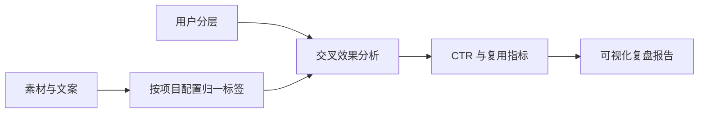
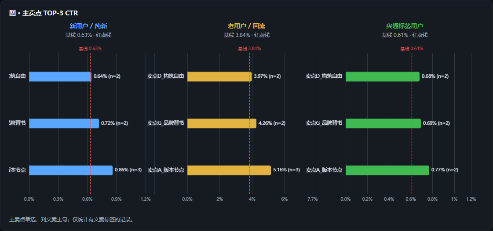

# 文案卖点 × 图片素材用户偏好分析

> **版本 v1.2.0（偏好分析进阶版）** · 变更记录见 `CHANGELOG.md` · 使用许可见 `LICENSE`
>
这套工作流分别标注文案和图片，再按用户分层比较卖点、行动钩子和视觉标签的加权 CTR。游戏、平台和标签体系都由配置文件提供，因此同一套分析流程可以迁移到不同项目。

仓库还包含大盘对比、复用衰减、素材缺口和资源需求表。示例数据均为合成值，不含真实游戏、平台、客户、内部文档 ID 或人员信息。在线表格连接器是可选通道；图表库的许可见 `THIRD_PARTY_NOTICES.md`。

v1.2.0 增加了文案标签、人群归一、素材继承和三联图报告。方法与字段约定见 `skills/ad-material-review/references/copy-analysis.md`。



**场景模板**：游戏、平台、渠道和对标对象在 `examples/config.demo.json` 中均使用可替换占位值；示例指标是合成数据，不代表真实项目。在线表格是可选连接器示例，不是离线分析的前置条件。

## 报告预览

[打开完整 HTML 场景报告](examples/copy-visual-preference-report.html)



截图由仓库自带的分析与报告脚本生成，使用 `examples/` 中的合成数据。图中的人群和指标只能在各自口径内比较。

---

## 一、适用问题

这套工作流适合处理以下问题：

- 新用户、老用户和标签用户分别偏好哪些文案卖点与图片方向？ → 文案卖点 × 图片素材用户偏好分析
- 哪种画风的素材更吸引人？画面上放不放福利、怎么放有没有用？ → **素材复盘**
- 老用户 / 新用户分别吃哪一套？下轮资源怎么分？ → **用户分层分析**
- 一张图反复投会不会越投越没效果？跟平台上别的游戏比算什么水平？ → **大盘对比 / 复用衰减**
- 下个月要新做多少张图、优先做什么方向？ → **缺口测算 / 排期**
- 要在某平台申请资源位、向合作方收一堆素材，怎么把规则和交期讲清楚？ → **资源需求表**
- 一堆资料要复盘整理，怎么不跑偏、不留错口径？ → **复盘框架**

仓库包含 3 个可安装 Skill、一套配置、12 个分析与验证脚本、方法文档、报告模板和离线图表库。

### 主题 → 包里对应什么

| 你说的主题 | 包里落在哪 |
|---|---|
| **文案卖点 × 图片素材用户偏好分析**（主线） | `ad-material-review/references/copy-analysis.md`（方法）+ `scripts/analyze_copy.py`（归一/继承/挂接/交叉）+ `scripts/build_report_copy.py`（三联图报告）+ `config.copy`（配置） |
| 用户研究 / 用户分析 | `references/user-analysis.md`（分层 × 文案卖点 × 图片标签 × CTR）+ `analyze.py` 分层维度 |
| 素材管理 | `ad-material-review`（打标、索引、重命名、缺口）+ `channel-resource-table`（收素材、排交付） |
| 游戏数据复盘 | `ad-material-review`（七阶段复盘全流程、大盘 Benchmark、复用衰减、报告） |
| 复盘 / 整理方法论 | `retrospective`（弹性框架、三条底线） |

> 说明：原素材里**没有**一个叫「用户研究」的独立工具，这块能力是长在素材复盘里的（按人群分层看效率、按标签找哪类素材打动谁）。本版把它**单独抽成一份通用方法文档**，并把「文案卖点 × 用户偏好」做成完整可跑的主线能力，让五类主题都齐。

---

## 二、三个 Skill 一览

| Skill | 用途 | 主要产物 |
|---|---|---|
| **ad-material-review** | 文案卖点、图片素材与用户偏好交叉分析，同时处理投放素材复盘与效果归因 | 文案/图片两套打标明细、各人群偏好三联图 HTML 报告、多维度 CTR 归因、大盘双口径对比、复用衰减、缺口测算 |
| **channel-resource-table** | 渠道资源/素材需求表制作 | 成对交付的「全景表」（内部）+「需求表」（对外） |
| **retrospective** | 复盘 / 整理 / 总结的弹性框架 | 不产出文件，规定「这类活该怎么推进」 |

三者的关系（业务闭环）：

```
   retrospective（怎么复盘整理）
            │ 方法论贯穿
            ▼
   channel-resource-table ──→ 投放 ──→ ad-material-review ──→ 下一轮素材
   （向前看：这次收什么素材）        （向后看：做过的哪类好）
```

---

## 三、包结构

```
文案卖点 × 图片素材用户偏好分析_分发版/
├── README.md                          ← 本文件（总入口）
├── LICENSE                            ← 使用许可：可自由使用 / 修改 / 分发
├── VERSION                            ← 版本号（当前 v1.2.0）
├── CHANGELOG.md                       ← 版本变更记录
├── .gitignore                         ← 防止真实配置与数据误提交
├── 迁移到新游戏指南.md                 ★ 换一款游戏，一步一步怎么做
├── 分享包文档/
│   ├── 安装与前置条件.md               装之前要准备什么
│   ├── 使用示例与提示词.md             怎么调用、示例提示词
│   ├── 团队定制清单.md                 换团队要改哪几处
│   └── 避坑指南.md                     踩过的坑，建议先看
├── examples/                          全假数据，可安全外发
│   ├── README.md                      空跑命令
│   ├── config.demo.json               填好的示例配置（含 copy 区块）
│   ├── master.sample.csv / tagged.sample.csv / labels.sample.json
│   ├── bench.json / bench_materials.json
│   └── copy_*.sample.*                ★ 主线假数据：规划表/文案标签/旧台账/索引
└── skills/
    ├── ad-material-review/           ★ 主线技能
    │   ├── SKILL.md + 说明文档.md + README.md（技术向）
    │   ├── config/  (config.example.json / config.schema.md / presets×2，均含文案标签体系)
    │   ├── scripts/ (11 个 .py + 1 个 .js 验证，全部读 config / 纯标准库)
    │   │             ★ analyze_copy.py / build_report_copy.py / verify_html_charts.js
    │   ├── references/ (6 份方法论)   ★ copy-analysis.md（主线方法）
    │   └── assets/  report_template.html / report_template_copy.html / echarts.min.js（随包自带画图库）
    ├── channel-resource-table/
    │   ├── SKILL.md + 说明文档.md
    │   ├── config/spec.example.json
    │   ├── scripts/ (2 个)
    │   └── references/ (5 份)
    └── retrospective/
        ├── SKILL.md + 说明文档.md
```

每个 Skill 都配有 `说明文档.md`，用图示和业务语言解释用法；`SKILL.md` 保存 Agent 执行时遵守的规则。

---

## 四、三分钟快速开始

### 方式 A：只想先看懂（不用装）
直接读 `skills/*/说明文档.md`，或看 `examples/` 里的数据长什么样。

### 方式 B：把脚本空跑一遍（不联网、不需要授权）
从**包根目录**执行（能看到本 README 和 `examples/` 的那一层）：

```bash
# 常规素材复盘
python skills/ad-material-review/scripts/analyze.py \
  --config examples/config.demo.json \
  --csv examples/tagged.sample.csv \
  --out examples/out/analysis.json

# 主线：文案卖点 × 图片素材用户偏好分析（三步，全离线）
python skills/ad-material-review/scripts/analyze_copy.py \
  --config examples/config.demo.json \
  --planning examples/copy_planning.sample.csv \
  --labels examples/copy_labels.sample.json \
  --master examples/copy_master.sample.csv \
  --tagged examples/copy_tagged.sample.csv \
  --index examples/copy_index.sample.csv \
  --out-base examples/out/copy_base.csv \
  --out-json examples/out/copy_results.json
python skills/ad-material-review/scripts/build_report_copy.py \
  --config examples/config.demo.json \
  --results examples/out/copy_results.json --out examples/out/copy_report.html
node skills/ad-material-review/scripts/verify_html_charts.js examples/out/copy_report.html 4
```
能打印出各人群基线/TOP 卖点、生成 `copy_report.html`、且验证脚本报「4 图全渲染」就说明主线跑通了。
完整命令见 `examples/README.md`。`node` 那步是可选的运行级验证（需装 Node），不装也不影响前两步与主流程。

### 方式 C：装成 Skill 给 Agent 用
把 `skills/` 下的三个目录整目录拷到你的 Agent 的 skills 目录（`{{SKILL_ROOT}}/`），
然后按 `分享包文档/安装与前置条件.md` 配好依赖即可。详见下一节。

---

## 五、安装与前置条件（摘要）

> 完整版见 `分享包文档/安装与前置条件.md`。

1. **Python 3.8+**（脚本只用标准库，无需 pip 安装）
2. **在线表格 / 智能文档能力**（`table-cli` 或你们自己的 CLI）——只在「接真实数据源」时需要；空跑分析不需要
3. **多模态看图能力**——逐张给素材图打标签时需要
4. **一份平台规则文档**（用 `channel-resource-table` 时）
5. **复制配置文件**：`cp skills/ad-material-review/config/config.example.json skills/ad-material-review/config/config.json`，按 `config.schema.md` 填真实值

> 原表一律只读。所有写操作都指向新建的子表或文档。

---

## 六、怎么迁移到别的游戏 / 平台（核心设计）

所有项目专属信息都写入 `config.json`。迁移到新项目时替换配置，不改脚本和文档。

```
        config/config.json
  游戏名·平台·子表名·字段名·标签体系·
  节点档期·对标游戏·图片域名·叙事策略
              │
      ┌───────┼────────┐
      ▼       ▼        ▼
   取数脚本  分析脚本  报告模板
   （都不写死游戏信息）
```

要改的 10 类东西：`project` / `source` / `fields` / `taxonomy`（含**文案标签**）/ `nodes` / `benchmark` / `thresholds` / `output` / `report` / **`copy`（主线进阶）**。
**一步一步的操作见《迁移到新游戏指南.md》**，逐字段说明见 `skills/ad-material-review/config/config.schema.md`。
做主线分析时，`copy.segment_map` 要覆盖源表所有人群写法、`core_segments` 定对、`chart_dims` 按需增删。

包里还给了**两套示例标签预设**（`config/presets/`：偏暗黑幻想 / 偏科幻射击），
演示「同一套流程、两套标签」怎么工作——连**文案标签**都各给了一套（版本/福利/职业… vs 上线/通行证/赛事…），
但脚本、分析维度、报告模板一模一样。

---

## 七、报告叙事：一个业务规矩做成了开关

不同业务方对「报告能不能写排名、垫底」要求不同，所以做成配置开关 `report.narrative`：

| 值 | 报告写什么 | 适用 |
|---|---|---|
| `neutral` | 客观全量 | 内部复盘 |
| `positive_only` | 只写优势与环比进步；排名/分位/垫底不进报告 | 给更上层看的汇报 |
| `full` | 全量含排名 | 明确要求完整披露 |

**关键**：用 `positive_only` 时，扎心数据（排名、分位、与头部差距）**仍要算出来留档**，
只是不写进报告，交付时口头/私信告知业务方本人——「不隐瞒，但不写进给更上层看的报告」。
详见 `ad-material-review/说明文档.md` 第六节。

---

## 八、脱敏说明（本包做了什么）

| 敏感项 | 处理方式 |
|---|---|
| 游戏名 / 平台名 | 使用 `GAME_A`、`PLATFORM_A`、`CHANNEL_A` 等可配置占位值 |
| 真实 CTR / 曝光 / 金额 | 全部换成占位 `X.XX%` / `N`，或标注「示例」的编造数据 |
| 运营档期 / 版本号 | 换成「节点A/B」「档期一/二」等抽象名 |
| 用户分层名 | 换成「分层A_纯新」等抽象名 |
| 内部文档 ID / 内网链接 / CDN 网址 | 换成 `<DOCID>` / `cdn.example.com` 占位 |
| 人名、团队名、具体日期来源 | 全部移除 |
| 两套同源 skill | 合并成一套通用工作流，差异抽象成 `source.mode` 与 `report.narrative` 开关 |
| 脚本里的硬编码 | 全部抽到 config，脚本读配置，不写死任何游戏信息 |

**正式使用前**：把 `config.json` 的占位值换成真实值，把 `output.cdn_base` 换成你们平台图片域名；
不要把真实业务数据写回脚本或提交到公开仓库。

---

## 九、常见问题

**Q：不联网能用吗？报告发出去、断网还能看到图吗？**
A：能。分析类脚本（`analyze.py` / `benchmark.py` / `reuse_map.py` / `analyze_copy.py` 等）读本地 CSV/JSON，完全离线可跑；取数与写表脚本需要在线表格授权。**本包所有 HTML 报告都离线自包含**——画图库 `echarts.min.js` 随包自带并内嵌进 HTML，双击打开、转发给别人、断网都能出图，绝不依赖 CDN。`examples/` 就是给离线空跑用的。

**Q：换成一个完全不同类型的游戏（比如卡牌、二次元）能用吗？**
A：能。改 `taxonomy` 的标签体系即可（画风/元素/福利按你的品类重写），其余流程不变。`presets/` 演示的就是两种不同品类共用一套流程。

**Q：字段跟我们表里的列名不一样怎么办？**
A：只改 `config.fields` 的「右边」（源表真实列名），脚本内部列名不用动。

**Q：一定要用在线表格吗？**
A：不强制。脚本里的在线表格调用是可选通道；把数据导出成 `master.csv` 形态后，分析与报告环节完全可离线跑。通过环境变量 `TABLE_TOOL_CLI` 可把默认的 `table-cli` 切换为使用方自己的兼容命令。

**Q：为什么有两个 `说明文档.md` 和 `SKILL.md`？**
A：`说明文档.md` 面向使用者，包含业务说明和图示；`SKILL.md` 面向 Agent，保存执行规则。

---

## 十、验收与自检记录

本包按「可作为分发版」的标准复核，通过 11 项自检（v1.2.0 新增 8–11 项专项，逐项方法见 `分享包文档/避坑指南.md` 末尾）：

| # | 自检项 | 结果 |
|---|---|---|
| 1 | 脱敏扫描：具体项目绑定的游戏/平台/客户名、人名、内部文档 ID、内网域名、真实业务数字与本地路径 | 未发现具体项目值；样例用占位符 |
| 2 | 技能可安装：3 个 `SKILL.md` 的 frontmatter 均含 `name` / `description` / `agent_created` | 规范 |
| 3 | Python 脚本依赖：全部 `.py` 仅用 Python 标准库 + 包内模块；报告模板另行捆绑 ECharts，许可见 `THIRD_PARTY_NOTICES.md` | 无需 `pip install` |
| 4 | 脚本语法：全部 `.py` 通过 `py_compile` | 通过 |
| 5 | 数据可解析：全部 JSON 通过解析；HTML 报告模板占位符完整、替换后 0 残留 | 通过 |
| 6 | 离线空跑：`analyze.py` / `benchmark.py` / `reuse_map.py` **+ 主线 `analyze_copy.py` / `build_report_copy.py`** 用假数据跑通 | 通过 |
| 7 | 包完整性：zip 校验通过、无缓存 / 临时产物、包内文件与构建目录逐一一致 | 通过 |
| 8 | **HTML 离线自包含**：报告零渲染依赖外链、画图库已内嵌 | 通过 |
| 9 | **运行级渲染验证**：`verify_html_charts.js` 真实执行画图代码，三联图报告 4 图全部画出 SVG | 通过 |
| 10 | **config 换值空跑**：换一套人群/标签取值后主线脚本仍跑通（配置是唯一事实源） | 通过 |
| 11 | **版本一致**：`VERSION` / `CHANGELOG.md` / `README.md` 三处版本号一致（v1.2.0） | 通过 |

---

## 十一、版本 / 许可 / 维护与反馈（分发方请先看）

### 版本与改动怎么追

- 当前版本写在 `VERSION`（本版 `v1.2.0`），只此一处是版本号的准。
- 每次改动追加到 `CHANGELOG.md`：改了什么、为什么改、影响哪些文件。改脚本逻辑请升次版本号，只改文档/错别字升修订号。
- 报问题或提需求时附上版本号 + 涉及的文件名，定位会快很多。

### 许可：能怎么用

本包自有文档、脚本、配置与合成示例按 `LICENSE`（MIT）授权。捆绑的 ECharts 与组件不由本包 MIT 许可覆盖，须同时遵守 `THIRD_PARTY_NOTICES.md` 和 `LICENSES/` 中的上游许可。

再分发时请保留相应的版权与许可声明；所有许可均按原文提供，不作额外担保。

### 维护与反馈：边界说清楚

- 本包是**脱敏通用模板**，不含任何具体维护人、团队名或联系方式。
- 转发给外部前，请由分发方在 `分享包文档/团队定制清单.md` 补上「谁维护、有问题找谁、按哪套规矩改」——**这一步不做，接收方会不知道该找谁**。
- 建议把 `.gitignore` 一起保留：它挡住真实 `config.json`、`data/`、素材图、空跑产物，避免接收方填完真实数据后误提交到版本库。

### 分发前 5 项自检（发给别人之前过一遍）

1. **再扫一次敏感词**：确认没人把具体项目游戏名 / docid / 内网地址 / 真实数字写回文件；占位符和合成样例可保留。
2. **确认 `config/config.json` 不存在**：包里只应有 `config.example.json` 和 `config.demo.json`；真实配置绝不进包。
3. **确认能空跑**：解压后从包根目录跑一次 `examples/README.md` 里的空跑命令（常规 + 主线），能出结果再发。
4. **确认 HTML 零外链**：生成的报告 `<script>/<link>/` 的 src/href 无 `http(s)://` 外链，画图库已内嵌。
5. **确认图能画出来**：跑了 `verify_html_charts.js` 运行级验证、每张图都真实渲染出 SVG，再发（这条最容易漏，白屏事故就出在这）。

---

*本包为通用工作流模板，占位符与示例数据替换后方可用于真实项目。*
